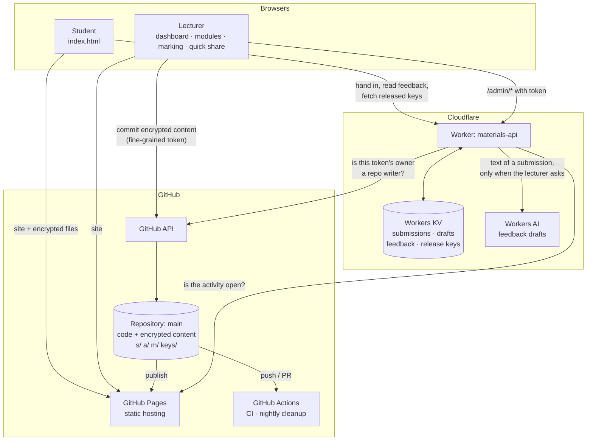
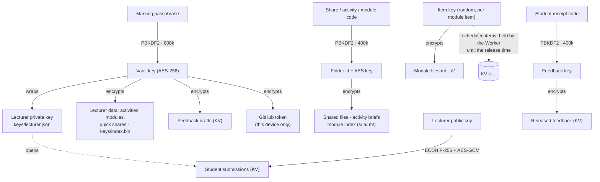
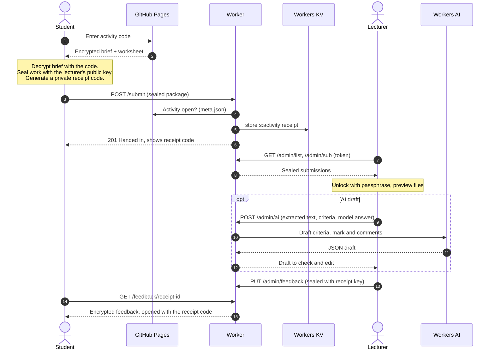
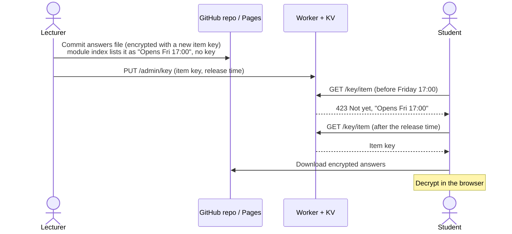
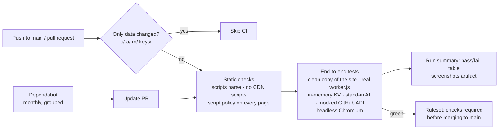

# Materials Share — GitHub Pages edition

[](https://github.com/muhammed-sihan-haroon/materials-share/actions/workflows/ci.yml)

Share class materials with an 8-character code (e.g. `V2WV-AF63`), collect student work for activities, and return feedback — hosted free on GitHub Pages (optionally on your own domain) plus a free Cloudflare Worker for uploads.

Students use **one code box** on the home page for everything: a materials code, an activity code (to hand in), or their receipt code (to read feedback).

## Architecture

Materials Share has no server of its own to look after. A **static site on GitHub Pages** does all the encryption in the browser, a **small Cloudflare Worker** accepts uploads and hands out keys at the right time, and **GitHub Actions** tests every change.

### System overview



### What is encrypted, and who can read it

Everything sensitive is encrypted **in the browser** before it leaves the device. GitHub and Cloudflare only ever store ciphertext.



| Data | Stored in | Encrypted with | Readable by |
|---|---|---|---|
| Shared files, activity briefs, module index | GitHub repo (`s/`, `a/`, `m/`) | Key derived from the code | Anyone with the code |
| Module files | GitHub repo (`m/…/f/`) | Random item key | Module code holders, once published or released |
| Student submissions | Cloudflare KV | Lecturer's public key | Lecturer (marking passphrase) |
| Feedback drafts | Cloudflare KV | Vault key | Lecturer |
| Released feedback | Cloudflare KV | Key derived from the receipt code | The student with the receipt |
| Lecturer's private key and data | GitHub repo (`keys/`) | Vault key | Lecturer |
| GitHub token | Lecturer's browser | Vault key | Lecturer, on that device |

### A student hands in work and gets feedback



### Answers that unlock on time



### CI pipeline



### Repository layout

```text
index.html          student page: one box for module, materials, activity and receipt codes
dashboard.html      lecturer home: needs attention, coming up, module cards
modules.html        module file manager: weeks, drafts, publish, schedule
review.html         activities and marking, AI drafts
admin.html          quick share
lecturer.js         lecturer sign-in, session, shared helpers
shared.js           crypto and data formats used by every page
gh.js               GitHub API helpers (commits)
config.js           site name, salt, submissions service address
style.css           design system
worker.js           Cloudflare Worker: submissions, feedback, release keys, AI drafts
vendor/             self-hosted JSZip, Mammoth (Word), PDF.js
s/  a/  m/  keys/   published content, all encrypted (written by the site)
tests/              static checks, end-to-end suite, local worker runner
.github/            CI, nightly cleanup, Dependabot
```

## How it works

- **You** open `admin.html`, pick files, and press *Encrypt, upload & create code*. Your browser encrypts everything (AES-256-GCM) with a key derived from a fresh random code, then commits the encrypted files to this repo. A presenter screen shows the address and code for the projector.
- **Students** open the site, type the code (or follow `site/#CODE`). Their browser derives the same key, fetches the encrypted files and decrypts them locally. Single files or "Download all" as a zip.
- **The repo only ever contains ciphertext.** Titles, file names and contents are all encrypted; folder names are derived from the code via PBKDF2 (400,000 rounds), so they reveal nothing.
- **Expiry**: the student page refuses expired shares, and a daily GitHub Action deletes expired folders.

## Set up (about 10 minutes)

1. **Create a repository** on GitHub, e.g. `materials`.
   - Free account → must be **public** (the files in it are encrypted, so that's fine).
   - GitHub Pro / Team → can be private.
2. **Upload this folder's contents** to the repo root, including the hidden `.github` folder. Easiest with git:
   ```bash
   cd materials-share-github
   git init -b main && git add -A && git commit -m "Materials Share"
   git remote add origin https://github.com/YOUR-USERNAME/materials.git
   git push -u origin main
   ```
3. **Turn on Pages**: repo → *Settings → Pages* → Source: *Deploy from a branch* → `main` / `(root)` → Save. After a minute your site is at `https://YOUR-USERNAME.github.io/materials/`.
4. **Allow the cleanup job to commit**: *Settings → Actions → General → Workflow permissions* → *Read and write permissions*.
5. **Create an upload token**: GitHub → *Settings → Developer settings → Personal access tokens → Fine-grained tokens → Generate new token*
   - Repository access: *Only select repositories* → this repo
   - Permissions: *Contents → Read and write* (nothing else)
   - Expiry: e.g. 90 days (you'll just paste a new one when it runs out)
6. Open `https://YOUR-USERNAME.github.io/materials/admin.html`, paste the repo name and token, tick *Remember on this device* if it's your own machine, and press **Connect**.

## Your own domain (optional)

1. At your domain's DNS provider add a **CNAME** record: `get` → `YOUR-USERNAME.github.io`
2. Repo → *Settings → Pages → Custom domain* → `get.yourdomain.com` → Save, then tick **Enforce HTTPS** once it's offered (can take up to an hour).

Students then go to `get.yourdomain.com`.

## Day to day

- New share: `admin.html` → files → create. Live within about a minute.
- **Show** re-opens the presenter screen; **Delete** removes the share immediately (GitHub's cache may serve it for up to ~10 minutes).
- The share list lives in the browser you created it from. Codes can't be recovered from the repo — that's what keeps them secret. Use the same browser, or note codes down.

## Limits and honest caveats

- **50 MB per file**; keep the whole repo under ~1 GB (GitHub Pages limit). Delete old shares each semester.
- **No download counts or download caps** — a static site can't count.
- **Code strength**: 8 characters from 31 symbols (~850 billion combinations), each guess costing 400k PBKDF2 rounds. Fine for teaching materials; don't use it for anything confidential (personal data, exam papers).
- **Deleted files remain in git history** (still encrypted). For a clean slate, delete and recreate the repo.
- `config.js` holds your site's salt. **Never change it** after sharing codes, or every existing code stops working.


## Lecturer pages

- **Dashboard** (`dashboard.html`) is your home page: work waiting for feedback, deadlines and scheduled releases in the next two weeks, and a card per module.
- **Modules** (`modules.html`): one student code per module for the whole semester. Each module has weeks; drag files onto a week (or use *Add files*) and they arrive as **drafts** with a guessed type (Material, Worksheet, Answers). Publish, unpublish, schedule, edit, move between weeks, reorder, delete, search.
  - **Scheduled** items (e.g. answers) are listed for students with "Opens …" and unlock by themselves at that time: the item's key is held by the submissions service and handed out only after the release time.
  - **Add activity** links an activity into a week; students open it from the module page. New activities can also be added to a module week when you create them.
- **Activities & marking** (`review.html`) and **Quick share** (`admin.html`, one-off files with their own code) work as before.

### Signing in

- Your **marking passphrase** signs you in on every lecturer page. The GitHub token is stored on your device only in encrypted form, locked by the passphrase, so you no longer paste it each time.
- *Stay signed in* keeps you signed in for 8 hours. The unlocked keys are kept as non-extractable browser keys, which pages can use but no script can copy out. **Sign out** clears them; use it on shared computers.
- All JavaScript libraries are served from this repo (`vendor/`), and lecturer pages refuse scripts from any other site.

## Submissions & feedback

### How it works

- **Activities** (`review.html` → *New activity*): title, instructions, optional deadline and mark, feedback criteria and your own quick comments. You get a code to show in class.
- **Students** enter the activity code, read the brief, upload files (20 MB total) with their name and student number, and get a **receipt code**.
- **You** open the activity, click a submission to preview it (PDF, Word, images, code, notebooks, zip listings), tick *Met / Partly met / Not yet* per criterion, add a mark and comments (click quick comments to insert them), then **Save draft** or **Save & release**. *Release all drafts* and *Export CSV* work per activity.
- **Students** enter their receipt code to read released feedback. *Withdraw* hides it again.

### Worksheets, model answers and AI drafts

- When you create an activity you can attach **worksheet files** (students download them from the activity page) and a **model answer or marking notes** (typed, or a Word/PDF/text file). The model answer is only ever seen by you and the AI checker.
- **AI draft all new** (or **Draft with AI** on one submission) reads each submission in your browser — Word, PDF, PowerPoint, Excel, notebooks, code, zips of code — and asks Cloudflare Workers AI to draft criteria judgements, a mark and formative comments against your criteria and model answer.
- Drafts are marked **AI draft** with the AI's one-line reason under each criterion (only you see the reasons). **Nothing reaches students until you release it.** Editing and saving a draft marks it as reviewed; *Release all drafts* warns you if any AI drafts haven't been edited.
- Images and scanned PDFs can't be read by the checker — look at those yourself.
- Free allowance: Workers AI includes 10,000 "neurons" a day, enough for roughly 50 drafts; it resets at 00:00 UTC. Set an `AI_MODEL` variable on the worker to try another model.
- Student work is sent as text to Workers AI only when you click an AI button; the student submit page tells students an AI tool may help draft feedback.

### Privacy

- Submissions are encrypted in the student's browser with your **public key**; only your **marking passphrase** can open them. The passphrase-protected private key lives in `keys/lecturer.json` in the repo. **If you forget the passphrase, submissions can't be recovered.**
- Feedback is encrypted with the student's receipt code. Drafts are encrypted with your passphrase.
- Cloudflare stores only ciphertext. The submissions service accepts lecturer requests only with a GitHub token whose owner can push to your repo.
- Use this for formative activities. Assessed coursework still belongs in Blackboard/Turnitin.
- Students identify themselves by typing name and student number; there is no student login.

### One-time setup (about 15 minutes)

**A. Create the Cloudflare service**

1. Sign up free at dash.cloudflare.com.
2. **Storage & databases → KV → Create namespace**, name it `materials-share`.
3. **Workers & Pages → Create → Create Worker**, name it `materials-share`, **Deploy**, then **Edit code**. Replace everything with the contents of `worker.js` and **Deploy**.
4. Worker → **Settings → Bindings → Add → KV namespace**: variable name `KV`, namespace `materials-share`. For AI drafts also **Add → Workers AI**, variable name `AI`.
5. Worker → **Settings → Variables and secrets → Add** (type *Text*):
   - `REPO` = `your-username/your-repo` (e.g. `muhammed-sihan-haroon/materials-share`)
   - `SITE_URL` = your site address without a trailing slash (e.g. `https://muhammed-sihan-haroon.github.io/materials-share`)
   Then **Deploy**.
6. Open the worker's `…workers.dev` address; it should say *Materials Share submissions service is running.*

**B. Point the site at it**

7. In the repo edit `config.js` and set `submitUrl: "https://materials-share.YOUR-SUBDOMAIN.workers.dev"`. Don't touch `salt`.
8. Upload the new/changed files: `index.html`, `review.html`, `admin.html`, `shared.js`, `gh.js`, `style.css` (and this README). `worker.js` doesn't need to be in the repo.

**C. First use**

9. Open `review.html`, connect with your token, create your marking passphrase.
10. Create a test activity, wait a minute, submit something from your phone, then review and release feedback.

### Limits

- Cloudflare free plan: 1,000 uploads/feedback saves per day, 1 GB storage, 20 MB per submission — comfortably enough for a few classes. Delete old submissions each semester (*Close submissions* stops new ones).
- New activities and *Close/Reopen* take about a minute to apply (GitHub Pages publishing).
- Anyone with an activity code can submit; check the name and student number you see.

## Development and CI

Every push to `main` and every pull request runs [`.github/workflows/ci.yml`](.github/workflows/ci.yml):

1. **Static checks** (`tests/check-syntax.mjs`): every JavaScript file and inline script parses, pages only load scripts from this site, and every page sets a script policy.
2. **End-to-end tests** (`tests/e2e.py`): serves a clean copy of the site (never your live `s/`, `a/`, `m/` or `keys/` data), runs the real `worker.js` under Node with an in-memory KV and a stand-in AI model, simulates GitHub's API, and drives lecturer and student flows in headless Chromium. Screenshots are kept as a build artifact for 7 days.

Commits that only change published data (shares, activities, modules) skip CI. Dependabot proposes monthly updates for the CI tools.

Run locally:

```bash
pip install -r tests/requirements.txt
python -m playwright install chromium
node tests/check-syntax.mjs
python tests/e2e.py
```
